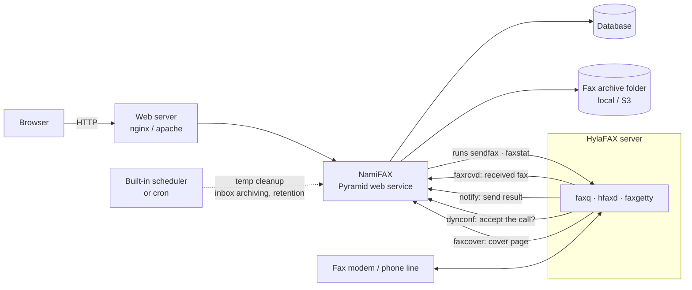
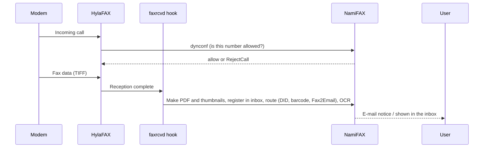
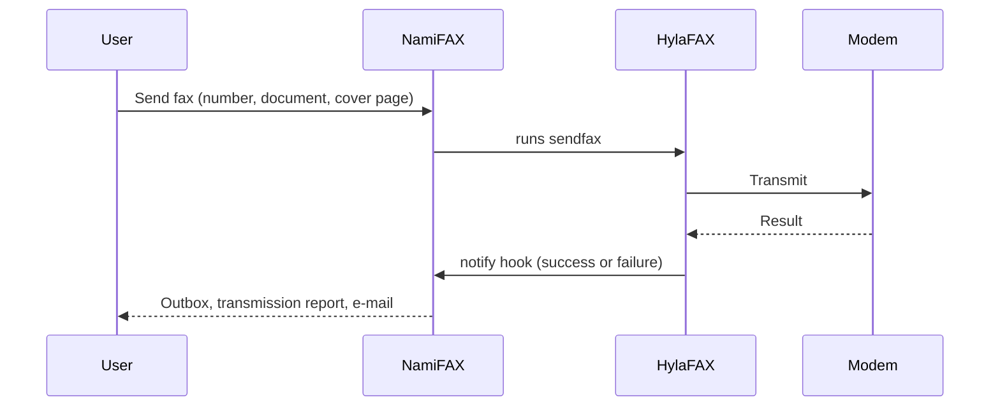

# Overview

## What NamiFAX is

NamiFAX is a web system for working with a HylaFAX fax server in a browser. It supports MySQL/MariaDB, PostgreSQL and SQLite databases.

## What you can do

- View received faxes in the browser, download them as PDF, rotate them and add notes.
- Send faxes (type numbers, pick from the address book or distribution lists) and follow jobs in the outbox.
- Search received and sent faxes in the archive by company, date, category and keyword. With OCR enabled the text of the fax is searchable too.
- Forward a received fax as a PDF to an e-mail address registered for the recognised sender number (Fax2Email).
- Choose the right company when several companies share one fax number.
- Route received faxes to a category and a contact by DID/DTMF number or by barcode.
- Block unwanted caller numbers so that HylaFAX rejects the call (`RejectCall`).
- Import e-mail addresses and fax numbers into the address book from vCard (`.vcf`) files.
- No limit on users or fax lines (modems).
- Each user sees the interface in their own language (24 languages; Korean is fully translated).

## Security and operations features

Two-factor authentication (TOTP) and passkeys, SAML sign-in, Argon2id password hashes, scheduled jobs configured from the admin screens, upload to S3-compatible storage with retention policies, and printing to fax (CUPS).

## Architecture

- Web service: the screens and administration. A built-in scheduler runs the periodic jobs.
- HylaFAX hooks: let NamiFAX handle a received fax (`faxrcvd`), the result of a sent one (`notify`), whether to accept a call (`dynconf`) and cover pages (`faxcover`). In the other direction NamiFAX runs `sendfax`, `faxstat` and so on on the same server to send faxes and read the status.
- Configuration lives in one file of environment variables, `/etc/namifax.env`.

### When a fax is received

### When a fax is sent

## License

See `LICENSE` and `NOTICE.txt` in the repository for the licensing terms.
