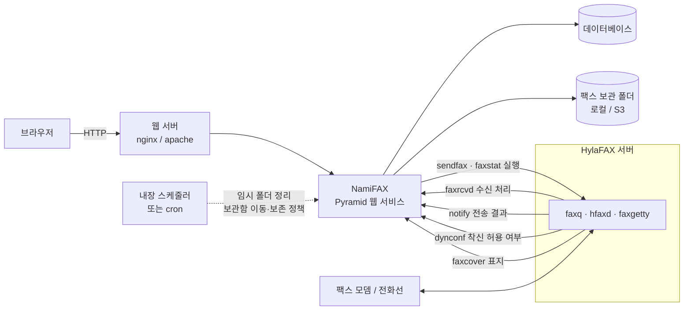
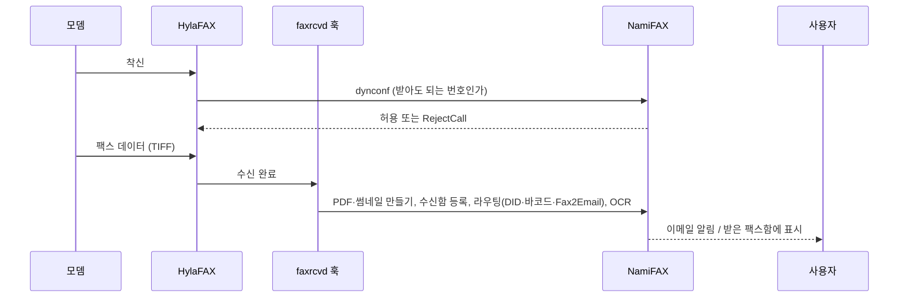
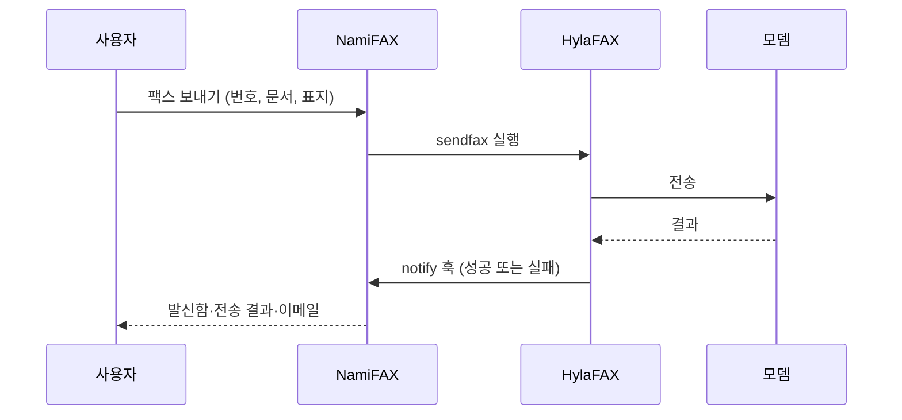

# 개요

## NamiFAX란

NamiFAX는 HylaFAX 팩스 서버를 브라우저로 다루게 해 주는 웹 시스템입니다. 데이터베이스는 MySQL/MariaDB, PostgreSQL, SQLite를 지원합니다.

## 할 수 있는 일

- 브라우저에서 받은 팩스를 보고, PDF로 내려받고, 회전하고, 메모를 남깁니다.
- 팩스를 보내고(번호 직접 입력, 주소록, 배포 목록), 발신함에서 작업 상태를 봅니다.
- 보관함에서 회사, 날짜, 분류, 키워드로 받은/보낸 팩스를 찾습니다. OCR을 켜면 팩스 본문도 검색됩니다.
- 인식된 발신 번호에 이메일 주소가 등록돼 있으면 받은 팩스를 PDF로 그 주소에 전달합니다(Fax2Email).
- 팩스 번호가 같은 회사가 여럿이면 어느 회사인지 골라 지정합니다.
- DID/DTMF 번호나 바코드로 받은 팩스를 분류와 담당자에게 보냅니다.
- 차단할 발신 번호를 등록해 HylaFAX가 착신을 거부하게 합니다(`RejectCall`).
- vCard(`.vcf`) 파일로 이메일 주소와 팩스 번호를 주소록에 가져옵니다.
- 사용자와 팩스 회선(모뎀)에 제한이 없습니다.
- 사용자마다 자기 언어로 화면을 봅니다(24개 언어, 한국어는 전체 번역).

## 보안과 운영 기능

2단계 인증(TOTP)과 패스키, SAML 로그인, Argon2id 비밀번호 해시, 관리자 화면에서 설정하는 정기 작업, S3 호환 스토리지 업로드와 보존 정책, 인쇄해서 팩스 보내기(CUPS).

## 구성

- 웹 서비스: 화면과 관리 기능. 내장 스케줄러가 정기 작업을 돌립니다.
- HylaFAX 훅: 팩스를 받았을 때(`faxrcvd`), 보낸 결과(`notify`), 착신 허용 여부(`dynconf`), 표지(`faxcover`)를 NamiFAX가 처리하게 연결합니다. 반대로 NamiFAX는 같은 서버에서 `sendfax`, `faxstat` 등을 실행해 팩스를 보내고 상태를 읽습니다.
- 설정은 `/etc/namifax.env`의 환경 변수 한 파일로 합니다.

### 팩스를 받을 때

### 팩스를 보낼 때

## 라이선스

라이선스의 구분은 저장소의 `LICENSE`와 `NOTICE.txt`에 있습니다.
